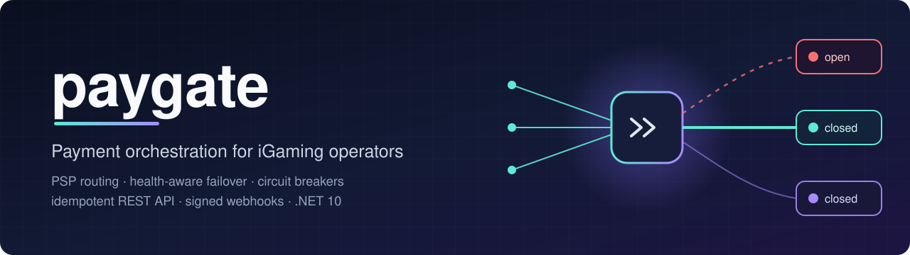
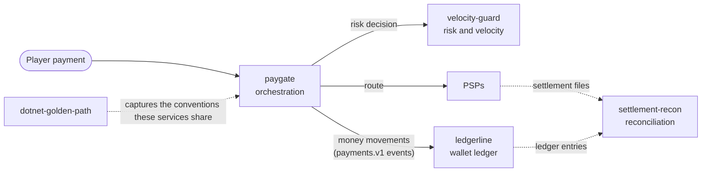
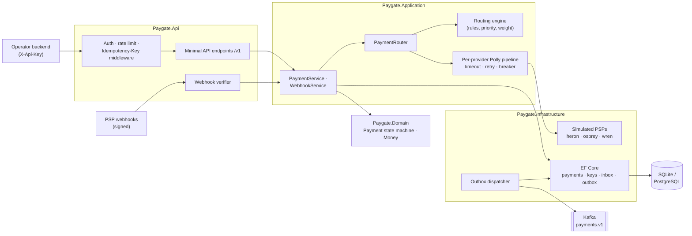
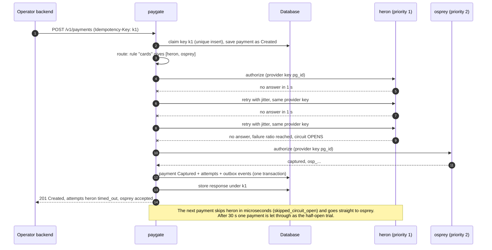
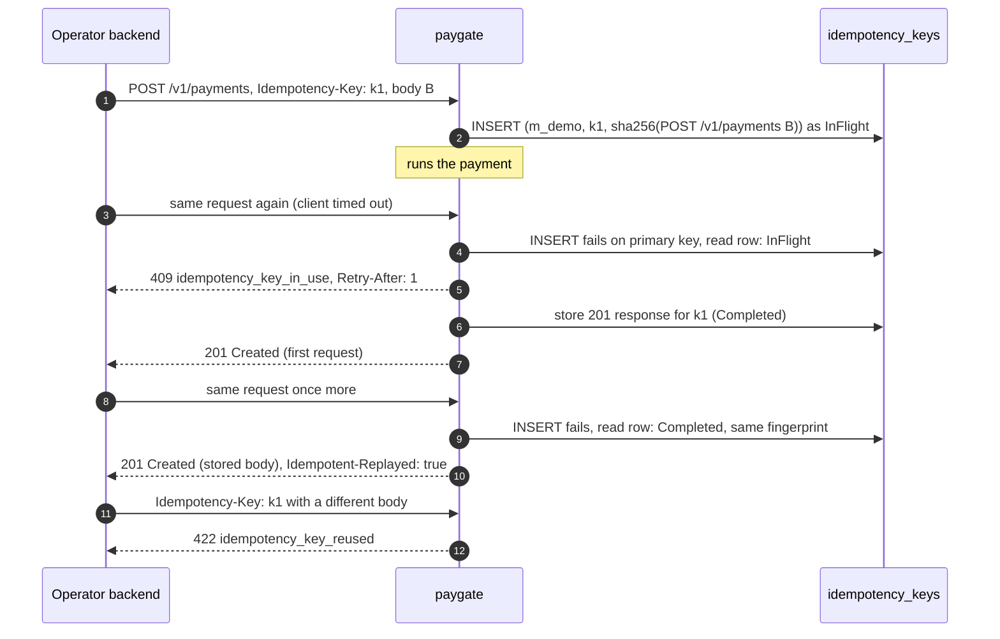
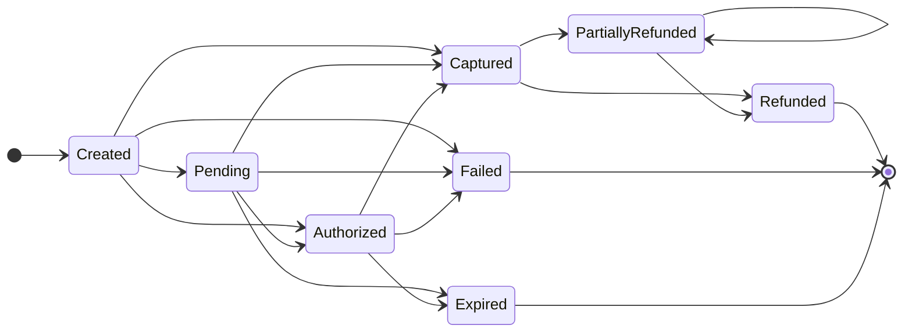

<div align="center">



# 💳 paygate

**Payment orchestration gateway for iGaming operators: routes deposits and payouts across PSPs with health-aware failover, Polly circuit breakers, idempotent REST APIs and signed webhooks.**

[](https://github.com/AutumnTrace/paygate/actions/workflows/ci.yml)
[](https://github.com/AutumnTrace/paygate/actions/workflows/codeql.yml)
[](https://github.com/AutumnTrace/paygate/releases)
[](LICENSE)

<br/>


[Quick start](#-quick-start) · [Architecture](#-architecture) · [Examples](#-example-requests) · [Failover demo](#-live-failover-demo) · [Design decisions](#-design-decisions) · [Benchmarks](#-benchmarks) · [Changelog](CHANGELOG.md)

</div>

---

## 🤔 Why this exists

An online casino or sportsbook rarely has a single payment provider. Cards go through one or two acquirers, Nordic players pay by bank transfer through a local provider, others use crypto, and payouts may go out through yet another route. Each provider has its own outages, timeouts and quirks, and every retry is a chance to charge a player twice. paygate sits between the operator and those providers: it picks the right provider for each payment, notices when one is failing and moves traffic away from it, makes every money-moving call safe to retry, and only trusts provider callbacks that are signed and fresh.

## ✨ Features

| | |
|---|---|
| 🧭 **Rule-based routing** | First-match routing table by kind, method, currency, country and amount band; priorities for failover order, weights for traffic splits |
| 🔀 **Health-aware failover** | One Polly v8 pipeline per provider (timeouts, retry with jitter, circuit breaker); open circuits are skipped in microseconds and recover through a half-open trial call |
| 🔁 **Idempotent REST API** | `Idempotency-Key` on every money-moving POST: stored responses replayed with `Idempotent-Replayed: true`, `422` on key reuse with a different body, `409` while in flight |
| 🛡️ **Safe retries only** | Providers are retried only when they deduplicate by idempotency key; declines are never retried or failed over; payout timeouts stay pending instead of paying twice |
| ✍️ **Signed webhooks** | HMAC-SHA256 over timestamp and raw body, 5-minute replay window, constant-time comparison, secret rotation, exactly-once processing, out-of-order safe |
| 🧱 **DDD core** | `Payment` aggregate with an explicit state machine, `Money` in minor units with ISO-4217 currencies, domain events |
| 📤 **Transactional outbox → Kafka** | Events written with the change that caused them, published in order to `payments.v1` with CloudEvents headers, keyed by payment id |
| 🔐 **Secure by default** | Per-operator API keys (SHA-256 at rest, constant-time compare), tenant isolation, token-bucket rate limiting, no card numbers accepted, RFC 9457 problem details |
| 🔭 **Observable** | OpenTelemetry traces, metrics and logs (OTLP or Azure Monitor), Serilog, circuit state as a gauge, provider latency histogram |
| 🧪 **Fault injection** | Three simulated providers with latency, error rate and outage switches, changeable at runtime through an admin API |
| 🗄️ **Zero-setup or full stack** | SQLite and an in-memory event publisher for `dotnet run`; PostgreSQL, Kafka and an Aspire dashboard in `docker compose` |
| 🐳 **Ship-ready** | Chiseled non-root image, health probes, CI with Testcontainers and a full-stack smoke test, CodeQL, GHCR releases |

## 🧩 Part of Payments Lab

paygate is one of five .NET 10 services for the payments side of a B2B iGaming platform.

| Repo | What it does |
|---|---|
| **[paygate](https://github.com/AutumnTrace/paygate)** 📍 **you are here** | **Payment orchestration gateway: PSP routing and failover, Polly circuit breakers, idempotent REST API, signed webhooks** |
| [ledgerline](https://github.com/AutumnTrace/ledgerline) | Double-entry wallet ledger: DDD + CQRS on EF Core/PostgreSQL, optimistic concurrency, transactional outbox to Kafka |
| [settlement-recon](https://github.com/AutumnTrace/settlement-recon) | Settlement reconciliation engine: streams PSP settlement files against the ledger, explains every mismatch |
| [velocity-guard](https://github.com/AutumnTrace/velocity-guard) | Real-time payment risk and velocity checks on Redis: sliding windows, HybridCache, sub-millisecond rule evaluation |
| [dotnet-golden-path](https://github.com/AutumnTrace/dotnet-golden-path) | `dotnet new` template for production .NET services: OpenTelemetry, Serilog, resilience, Testcontainers, Docker, Helm, CI |



> [!NOTE]
> Every repo runs and tests on its own; none needs another to start. The arrows are the integration points between them. In this repo, paygate publishes `payment.*` events to Kafka for a ledger to consume; the risk check is a planned integration (see the [roadmap](#-roadmap)).

## 🚀 Quick start

### Option A: just .NET (SQLite, nothing else to install)

```bash
git clone https://github.com/AutumnTrace/paygate.git
cd paygate
dotnet run --project src/Paygate.Api --launch-profile http
```

Open **http://localhost:5080/scalar/v1** for the interactive API reference. The database is created on first run, and events go to an in-memory publisher you can read at `GET /v1/admin/events`.

Demo credentials (Development only; only their SHA-256 hashes are in [`appsettings.Development.json`](src/Paygate.Api/appsettings.Development.json)):

| Key | Who | Can |
|---|---|---|
| `pgk_test_demo_7c2f9a41e8b35d06` | merchant `m_demo` (Demo Casino) | create and read payments, refunds, providers |
| `pgk_test_other_3b8e1d72c4a9f650` | merchant `m_other` | same, for its own payments only |
| `pgk_admin_demo_91d4e6f2a7c83b05` | `ops` (admin) | fault injection, circuit control, recent events |

### Option B: Docker compose (PostgreSQL, Kafka, telemetry dashboard)

```bash
docker compose up --build
```

| What | Where |
|---|---|
| API and Scalar UI | http://localhost:8080/scalar/v1 |
| Traces, metrics and logs (Aspire dashboard) | http://localhost:18888 |
| Kafka (from the host) | `localhost:29092`, topic `payments.v1` |
| PostgreSQL | `localhost:5432`, user/password `paygate` |

```bash
# watch the events arrive
docker compose exec kafka /opt/kafka/bin/kafka-console-consumer.sh \
  --bootstrap-server localhost:9092 --topic payments.v1 --from-beginning --property print.key=true
```

### Option C: prebuilt image

Each release is published to GitHub Container Registry:

```bash
docker run --rm -p 8080:8080 -e ASPNETCORE_ENVIRONMENT=Development ghcr.io/autumntrace/paygate:0.1.0
```

This runs on SQLite inside the container with the demo keys, which is enough for a quick look at http://localhost:8080/scalar/v1.

## 🏗 Architecture



The domain project has no dependencies at all. The application layer holds the use cases, routing and resilience, and talks to the outside through ports (`IPaymentProvider`, `IPaymentRepository`, `IIdempotencyStore`, `IWebhookInbox`, `IEventPublisher`).

### Deposit with failover

The primary acquirer times out, its circuit opens, and the deposit is captured by the next eligible provider. The next payment skips the open circuit without waiting.



### Idempotent replay



### Payment state machine



The transitions live in one table, [`PaymentStateMachine`](src/Paygate.Domain/Payments/PaymentStateMachine.cs). The API flow, refunds and webhooks all go through it, so an illegal move is impossible. Webhook updates that are not a legal forward move are acknowledged and ignored, which is how out-of-order delivery is handled.

### Routing table

The default table in [`appsettings.json`](src/Paygate.Api/appsettings.json), first match wins:

| Rule | Matches | Targets (priority, weight) |
|---|---|---|
| `high-value-eur-cards` | card, EUR, at least 5,000.00 | osprey (1), heron (2) |
| `nordic-cards` | card, SE / NO / DK / FI | heron (1, 70%), osprey (1, 30%) |
| `cards` | any card | heron (1), osprey (2) |
| `bank-transfers` | bank transfer | osprey (1) |
| `crypto` | crypto wallet | wren (1) |

| Simulated provider | Methods | Notes |
|---|---|---|
| `heron` | card | Card acquirer, all countries, deduplicates by idempotency key |
| `osprey` | card, bank transfer | Local provider for AT, BR, DE, DK, FI, NL, NO, PL, SE; bank transfers complete by webhook |
| `wren` | crypto wallet | Completes by webhook; **no idempotency keys**, so it is never retried; no refunds |

Amounts ending in `51` minor units (for example `25.51`) are declined by every simulator, like a test card that always fails.

## 🧪 Example requests

Every response below was captured from `dotnet run` on a fresh database (bodies pretty-printed; `// ...` marks fields left out for brevity). Amounts are integers in minor units: `2500` is 25.00 EUR.

```bash
export PG=http://localhost:5080
export KEY=pgk_test_demo_7c2f9a41e8b35d06      # merchant m_demo
export ADMIN=pgk_admin_demo_91d4e6f2a7c83b05   # ops (admin)
```

<details open>
<summary><b>Card deposit</b>: routed by the <code>cards</code> rule to heron and captured</summary>

```bash
curl -i -X POST $PG/v1/payments \
  -H "X-Api-Key: $KEY" -H "Idempotency-Key: 9b1d2c55-deposit-1" -H "Content-Type: application/json" \
  -d '{"amount":2500,"currency":"EUR","method":"card","country":"DE","customerId":"player-42","paymentToken":"tok_visa_4242"}'
```

```http
HTTP/1.1 201 Created
Location: /v1/payments/01a2087c-dbaf-7485-96f9-05c90dec2cf7
```

```json
{
  "id": "01a2087c-dbaf-7485-96f9-05c90dec2cf7",
  "kind": "deposit",
  "status": "captured",
  "amount": 2500,
  "currency": "EUR",
  "method": "card",
  "country": "DE",
  "customerId": "player-42",
  "provider": "heron",
  "providerReference": "hrn_0ff8216c42414dd9",
  "refundedAmount": 0,
  "attempts": [
    { "provider": "heron", "outcome": "accepted", "durationMs": 128 }
  ],
  "refunds": [],
  "createdAt": "2026-11-23T12:58:50.1602997+00:00",
  "updatedAt": "2026-11-23T12:58:50.3995161+00:00"
}
```
</details>

<details open>
<summary><b>Idempotent retry</b>: same key and body replays the stored response; a different body is rejected</summary>

Sending exactly the same request again (for example after a client timeout) does not create a second payment:

```http
HTTP/1.1 201 Created
Location: /v1/payments/01a2087c-dbaf-7485-96f9-05c90dec2cf7
Idempotent-Replayed: true
```

The body is byte-for-byte the one above. Reusing the key with `"amount":9900`:

```json
{
  "type": "https://tools.ietf.org/html/rfc4918#section-11.2",
  "title": "Unprocessable Entity",
  "status": 422,
  "detail": "This Idempotency-Key was already used with a different request. Use a new key for a new request.",
  "code": "idempotency_key_reused",
  "traceId": "f536dd9ccbd50bc1b37b5b497bfe628f"
}
```
</details>

<details>
<summary><b>Decline</b>: amounts ending in 51 are declined by the simulators, and declines are never failed over</summary>

```bash
curl -X POST $PG/v1/payments -H "X-Api-Key: $KEY" -H "Idempotency-Key: 4e7a-decline-1" -H "Content-Type: application/json" \
  -d '{"amount":2551,"currency":"EUR","method":"card","country":"DE","customerId":"player-42","paymentToken":"tok_visa_4242"}'
```

```jsonc
{
  "id": "01a2087c-dd3f-7627-8dbb-8acf2831d25a",
  "kind": "deposit",
  "status": "failed",
  "amount": 2551,
  // ...
  "failure": {
    "code": "insufficient_funds",
    "message": "Declined by heron. Declines are final and are not retried on another provider."
  },
  "attempts": [
    { "provider": "heron", "outcome": "declined", "durationMs": 108, "error": "insufficient_funds" }
  ]
  // ...
}
```
</details>

<details>
<summary><b>Partial refund</b>, and what happens when you ask for more than is left</summary>

```bash
curl -X POST $PG/v1/payments/01a2087c-dbaf-7485-96f9-05c90dec2cf7/refunds \
  -H "X-Api-Key: $KEY" -H "Idempotency-Key: 61c0-refund-1" -H "Content-Type: application/json" \
  -d '{"amount":1000,"reason":"duplicate bet"}'
```

```jsonc
{
  "refund": {
    "id": "01a2087c-de0b-75ff-b103-96a6374f5181",
    "amount": 1000,
    "currency": "EUR",
    "reason": "duplicate bet",
    "providerReference": "hrn_rf_6167428f71fa414d",
    "createdAt": "2026-11-23T12:58:50.9077248+00:00"
  },
  "payment": {
    "id": "01a2087c-dbaf-7485-96f9-05c90dec2cf7",
    "status": "partially_refunded",
    "amount": 2500,
    "refundedAmount": 1000
    // ...
  }
}
```

A second refund of `2000` on the same payment:

```json
{
  "type": "https://tools.ietf.org/html/rfc4918#section-11.2",
  "title": "Unprocessable Entity",
  "status": 422,
  "detail": "Cannot refund 20.00 EUR: only 15.00 EUR of 25.00 EUR is still refundable.",
  "code": "refund_exceeds_captured_amount",
  "traceId": "1fd239afdccc15368d702ee8a598ce82"
}
```
</details>

<details open>
<summary><b>Bank transfer + signed webhook</b>: pending until the provider confirms</summary>

A Swedish bank transfer goes to osprey and comes back `pending`:

```bash
curl -X POST $PG/v1/payments -H "X-Api-Key: $KEY" -H "Idempotency-Key: 2f8b-bank-1" -H "Content-Type: application/json" \
  -d '{"amount":50000,"currency":"SEK","method":"bank_transfer","country":"SE","customerId":"player-7"}'
```

```jsonc
{
  "id": "01a2087c-dee1-755c-9f32-e997e0b75ccb",
  "status": "pending",
  "amount": 50000,
  "currency": "SEK",
  "method": "bank_transfer",
  "provider": "osprey",
  "providerReference": "osp_037acf49b8d04232",
  // ...
}
```

Then the provider confirms it. The signature is `HMAC-SHA256(secret, "{timestamp}.{raw body}")`, so it can be produced with `openssl`:

```bash
SECRET=whsec_osprey_demo_8a3d6b1f0e9c2754      # demo secret from appsettings.Development.json
BODY='{"id":"evt_1001","type":"payment.captured","paymentId":"01a2087c-dee1-755c-9f32-e997e0b75ccb"}'
TS=$(date +%s)
SIG=$(printf '%s.%s' "$TS" "$BODY" | openssl dgst -sha256 -hmac "$SECRET" | sed 's/^.*= //')

curl -X POST $PG/v1/webhooks/osprey -H "Content-Type: application/json" \
  -H "Webhook-Timestamp: $TS" -H "Webhook-Signature: v1=$SIG" -d "$BODY"
```

```json
{
  "eventId": "evt_1001",
  "outcome": "applied",
  "paymentId": "01a2087c-dee1-755c-9f32-e997e0b75ccb",
  "paymentStatus": "captured",
  "detail": "The payment is now Captured."
}
```

| Delivered again | Body changed after signing | Timestamp 10 minutes old |
|---|---|---|
| `200` `"outcome": "duplicate"`, `"detail": "Already processed; nothing changed."` | `401` `"code": "invalid_signature"` | `401` `"code": "timestamp_outside_tolerance"` |
</details>

<details>
<summary><b>Validation and auth errors</b> are RFC 9457 problem details</summary>

```bash
curl -X POST $PG/v1/payments -H "X-Api-Key: $KEY" -H "Idempotency-Key: 77aa-invalid" -H "Content-Type: application/json" \
  -d '{"amount":0,"currency":"EURO","method":"card","country":"de","customerId":""}'
```

```json
{
  "type": "https://tools.ietf.org/html/rfc9110#section-15.5.1",
  "title": "One or more validation errors occurred.",
  "status": 400,
  "errors": {
    "Amount": ["The field Amount must be between 1 and 100000000000."],
    "Currency": ["The field Currency must be a string with a minimum length of 3 and a maximum length of 3."],
    "Country": ["The field Country must match the regular expression '^[A-Z]{2}$'."],
    "CustomerId": ["The CustomerId field is required."]
  },
  "traceId": "06e42f7954cd555a50c549aea91c3bc6"
}
```

Without an API key: `401` with `WWW-Authenticate: ApiKey header="X-Api-Key"` and `"code": "unauthorized"`.
</details>

<details>
<summary><b>Domain events</b>: what the outbox published (in-memory publisher; Kafka in docker compose)</summary>

```bash
curl "$PG/v1/admin/events?limit=1" -H "X-Api-Key: $ADMIN"
```

```json
[
  {
    "id": "01a2087c-eec7-717a-8665-2967a78dae86",
    "type": "payment.status_changed.v1",
    "key": "01a2087c-ee47-7664-88f5-1625938a12ee",
    "occurredAt": "2026-11-23T12:58:55.0478+00:00",
    "data": {
      "eventId": "01a2087c-eec7-717a-8665-2967a78dae86",
      "eventType": "payment.status_changed.v1",
      "paymentId": "01a2087c-ee47-7664-88f5-1625938a12ee",
      "merchantId": "m_demo",
      "occurredAt": "2026-11-23T12:58:55.0478825+00:00",
      "kind": "deposit",
      "from": "created",
      "to": "captured",
      "provider": "heron",
      "amountMinor": 4000,
      "currency": "EUR"
    }
  }
]
```

On Kafka the same JSON is the message value, the key is the payment id, and `ce_id`, `ce_type`, `ce_source`, `ce_time` and `traceparent` travel as headers.
</details>

## 🔥 Live failover demo

Break the primary card acquirer through the admin API and watch traffic move. Same running instance as above; timings are curl's `time_total`.

**1. Make heron hang on every call**

```bash
curl -X PUT $PG/v1/admin/providers/heron/faults -H "X-Api-Key: $ADMIN" -H "Content-Type: application/json" \
  -d '{"outage":"timeouts"}'
```

**2. First deposit: three timed-out calls to heron, then osprey captures it (3.35 s)**

```bash
curl -X POST $PG/v1/payments -H "X-Api-Key: $KEY" -H "Idempotency-Key: c3d9-failover-1" -H "Content-Type: application/json" \
  -d '{"amount":4000,"currency":"EUR","method":"card","country":"DE","customerId":"player-9","paymentToken":"tok_visa_4242"}'
```

```jsonc
{
  "id": "01a2087c-e06f-7c45-bfbe-330e391c1721",
  "status": "captured",
  "provider": "osprey",
  "providerReference": "osp_00da7513ff704396",
  "attempts": [
    { "provider": "heron", "outcome": "timed_out", "durationMs": 3249, "error": "timed out (3 calls)" },
    { "provider": "osprey", "outcome": "accepted", "durationMs": 90 }
  ],
  // ...
}
```

**3. Second deposit: heron's circuit is open, so it is skipped without waiting (0.11 s)**

```jsonc
{
  "id": "01a2087c-ed93-77a1-a965-93e7b21142ae",
  "status": "captured",
  "provider": "osprey",
  "attempts": [
    { "provider": "heron", "outcome": "skipped_circuit_open", "durationMs": 0, "error": "circuit open" },
    { "provider": "osprey", "outcome": "accepted", "durationMs": 102 }
  ],
  // ...
}
```

**4. The providers endpoint shows it** (`GET /v1/providers`, trimmed to the live fields)

```json
[
  {
    "name": "heron",
    "supportsIdempotencyKeys": true,
    "circuit": { "state": "open", "openedAt": "2026-11-23T12:58:54.6249916+00:00" },
    "health": {
      "successRate": 0.75,
      "averageLatencyMs": 907.5,
      "totalCalls": 4,
      "lastError": "timed out (3 calls)",
      "lastErrorAt": "2026-11-23T12:58:54.6258708+00:00"
    },
    "faults": { "latencyMs": 120, "errorRate": 0, "outage": "timeouts" }
  },
  {
    "name": "osprey",
    "supportsIdempotencyKeys": true,
    "circuit": { "state": "closed" },
    "health": { "successRate": 1, "averageLatencyMs": 92.1, "totalCalls": 3 },
    "faults": { "latencyMs": 90, "errorRate": 0, "outage": "none" }
  },
  {
    "name": "wren",
    "supportsIdempotencyKeys": false,
    "circuit": { "state": "closed" },
    "health": { "totalCalls": 0 },
    "faults": { "latencyMs": 250, "errorRate": 0, "outage": "none" }
  }
]
```

**5. Recover.** Left alone, the breaker lets one payment through after 30 s and closes if it succeeds. To skip the wait, fix the fault and close the circuit by hand; the next deposit is back on heron (0.13 s):

```bash
curl -X PUT  $PG/v1/admin/providers/heron/faults -H "X-Api-Key: $ADMIN" -H "Content-Type: application/json" -d '{"outage":"none"}'
curl -X POST $PG/v1/admin/providers/heron/circuit/close -H "X-Api-Key: $ADMIN"
```

What the service logged during the demo:

```text
[14:58:52 WRN] Paygate.Resilience: Retrying heron (attempt 1) in 116 ms after TimeoutRejectedException
[14:58:53 WRN] Paygate.Resilience: Retrying heron (attempt 2) in 101 ms after TimeoutRejectedException
[14:58:54 ERR] Paygate.Resilience: Circuit for heron OPENED for 30 s (manual: False); traffic fails over to the next eligible provider
[14:58:54 WRN] Paygate.Application.Resilience.ProviderInvoker: Call to heron (deposit) failed: timed out (3 calls)
[14:58:54 WRN] Paygate.Application.Routing.PaymentRouter: Payment 01a2087c-e06f-7c45-bfbe-330e391c1721: failing over from heron (timeout)
[14:58:54 INF] Paygate.Application.Routing.PaymentRouter: Payment 01a2087c-e06f-7c45-bfbe-330e391c1721 routed: Accepted via osprey, status Captured after 2 attempt(s)
[14:58:54 INF] Paygate.Application.Routing.PaymentRouter: Payment 01a2087c-ed93-77a1-a965-93e7b21142ae: skipping heron, its circuit is open
[14:58:54 INF] Paygate.Application.Routing.PaymentRouter: Payment 01a2087c-ed93-77a1-a965-93e7b21142ae routed: Accepted via osprey, status Captured after 2 attempt(s)
[14:58:54 INF] Paygate.Resilience: Circuit for heron CLOSED (manual: True)
[14:58:55 INF] Paygate.Application.Routing.PaymentRouter: Payment 01a2087c-ee47-7664-88f5-1625938a12ee routed: Accepted via heron, status Captured after 1 attempt(s)
```

> [!TIP]
> Try `{"outage":"errors"}` (fails fast with a 503-style error), `{"errorRate":0.3}` (flaky) or `{"latencyMs":800}` (slow but healthy), and a payout to the crypto provider while it times out: it stays `pending` and is never sent twice.

## 🧠 Design decisions

Each decision is written up as an ADR with its context, consequences and the alternatives that were rejected.

- **Idempotency keys live in the main database**, claimed with a unique insert on `(merchant_id, key)`, so "first request wins" holds across instances and commits with the payment. [ADR 1](docs/adr/0001-idempotency-keys-in-the-database.md)
- **Routing is a first-match table; health is applied by the circuit breaker at call time.** Declines are final, technical failures fail over, timed-out payouts wait instead of risking a double payout. [ADR 2](docs/adr/0002-rule-based-routing-with-health-aware-failover.md)
- **A provider is retried only when the call is idempotent**, with a stable provider idempotency key and jitter; the breaker sits inside the retry. [ADR 3](docs/adr/0003-retry-only-idempotent-psp-calls.md)
- **Webhooks are authenticated by HMAC over timestamp and raw body**, deduplicated by an inbox row in the same transaction, and ordered by the state machine. [ADR 4](docs/adr/0004-webhook-verification-and-exactly-once-processing.md)
- **Domain events leave through a transactional outbox**, so they are never lost and never describe a rolled-back change. [ADR 5](docs/adr/0005-transactional-outbox-for-domain-events.md)

<details>
<summary><b>Smaller details</b></summary>

- **Money is `long` minor units plus an ISO-4217 `Currency`** that knows its exponent (JPY 0, EUR 2, KWD 3). Mixing currencies throws; overflow throws instead of wrapping.
- **UUIDv7 ids** (`Guid.CreateVersion7()`): time-ordered, so B-tree indexes stay compact.
- **Optimistic concurrency** on payments (`version` column bumped by the aggregate): a webhook and a refund racing on the same payment cannot both win.
- **Persist before calling the PSP.** A payment is saved as `Created` before any provider call, so a crash mid-call leaves a record to reconcile. Provider calls are not cancelled when the client disconnects; the result is stored under the idempotency key.
- **Domain errors map to problem details inside the endpoint**, so idempotent responses include them; each has a stable `code` (`refund_exceeds_captured_amount`, `idempotency_key_reused`, ...) and a `traceId`.
- **No card data.** Card deposits take a vault token (`tok_...`); raw card numbers fail validation. API keys and tokens are never logged.
- **Snake-case schema** on both databases; enums stored as strings; SQLite stores timestamps as sortable integers because it cannot order `DateTimeOffset` text.
</details>

## ✅ Testing

```bash
dotnet test --filter "Category!=Integration"   # unit + API tests, no Docker needed
dotnet test                                     # everything, Testcontainers needs Docker
```

| Suite | Count | What it covers |
|---|---|---|
| `Paygate.UnitTests` | 114 | State machine (every transition, reachability), `Money`, refunds, webhook ordering, FsCheck properties (refunds never exceed the capture, no sequence of webhooks moves a payment backwards); routing rules, priorities, amount bands, an 80/20 weight split over 10,000 plans; **failover on the real Polly pipelines**: timeout then failover, circuit opens and traffic moves, half-open recovery with `FakeTimeProvider`, declines never fail over, retries reuse the idempotency key, no retries without one, payout timeout stays pending; webhook signatures (tampering, replay window edges, rotation) |
| `Paygate.Api.Tests` | 59 | The whole app through `WebApplicationFactory`: idempotency (replay, mismatch, in-flight `409`, **6 concurrent duplicates make one payment**, per-merchant scope), refunds, live failover through the admin API, webhooks end to end, auth, per-client rate limits, outbox events, health probes, OpenAPI document, settings refused at start-up |
| `Paygate.IntegrationTests` | 7 | Testcontainers **PostgreSQL 17 and Kafka 4.3**: 10 concurrent duplicates make one payment and one key row, 8 concurrent webhook redeliveries apply once, optimistic concurrency rejects a stale refund, the expected indexes exist, events reach the topic in order with CloudEvents headers |

CI runs all three suites, collects coverage into the job summary, builds the Docker image, and boots the compose stack to make a real deposit and read its events back from Kafka.

## 🔭 Observability

| Signal | What you get |
|---|---|
| **Traces** | ASP.NET Core, HttpClient and Npgsql spans, plus `paygate.route` and one `psp deposit` / `psp payout` / `psp refund` client span per provider call; the request's `traceparent` travels with each event to Kafka |
| **Metrics** | `paygate.payments` (by kind, method, provider, status), `paygate.routing.failovers` (by provider and reason), `paygate.provider.duration` histogram (by provider, operation, outcome), `paygate.provider.circuit_state` gauge, `paygate.provider.circuit_transitions`, `paygate.webhooks`, `paygate.idempotency.requests`, Polly's `resilience.polly.*`, ASP.NET Core and runtime |
| **Logs** | Serilog: readable in development, compact JSON otherwise, also forwarded to OpenTelemetry with trace ids; hot paths use `LoggerMessage` source generation |
| **Exporters** | OTLP when `OTEL_EXPORTER_OTLP_ENDPOINT` is set (the compose file points it at the Aspire dashboard); Azure Monitor / Application Insights when `APPLICATIONINSIGHTS_CONNECTION_STRING` is set |
| **Health** | `/health/live` (process only) and `/health/ready` (database, and Kafka when enabled) |

## ⏱ Benchmarks

The gateway's own overhead per payment is small next to a PSP round trip (typically 100 ms or more). Measured with BenchmarkDotNet on this machine; the code is in [`benchmarks/Paygate.Benchmarks`](benchmarks/Paygate.Benchmarks/Benchmarks.cs).

```
BenchmarkDotNet v0.15.8, Windows 11 (10.0.26200.7623/25H2/2025Update/HudsonValley2)
AMD Ryzen 7 9800X3D 4.70GHz, 1 CPU, 16 logical and 8 physical cores
.NET SDK 10.0.401
  [Host]     : .NET 10.0.12 (10.0.12, 10.0.1226.42308), X64 RyuJIT x86-64-v4
  DefaultJob : .NET 10.0.12 (10.0.12, 10.0.1226.42308), X64 RyuJIT x86-64-v4
```

**Routing** (the default five-rule table, three providers):

| Method | Mean | Error | StdDev | Allocated |
|---|---:|---:|---:|---:|
| Plan: weighted split (`nordic-cards`) | 363.3 ns | 6.83 ns | 15.28 ns | 1768 B |
| Plan: priority failover (`cards`) | 257.2 ns | 5.13 ns | 5.27 ns | 1304 B |
| Plan: last rule (`crypto`) | 178.2 ns | 3.49 ns | 4.28 ns | 976 B |

**Security checks on every request:**

| Method | Mean | Error | StdDev | Allocated |
|---|---:|---:|---:|---:|
| Webhook verify (1 secret) | 895.9 ns | 18.57 ns | 53.86 ns | 992 B |
| Webhook verify (2 secrets, rotation) | 1,476.9 ns | 29.48 ns | 53.91 ns | 1528 B |
| Idempotency fingerprint (SHA-256) | 330.4 ns | 6.64 ns | 18.06 ns | 456 B |

**Resilience pipeline overhead** (a provider call that succeeds immediately):

| Method | Mean | Error | StdDev | Ratio | Allocated |
|---|---:|---:|---:|---:|---:|
| Direct provider call | 11.53 ns | 0.270 ns | 0.668 ns | 1.00 | 144 B |
| Through pipeline (timeout, retry, breaker, timeout) | 602.97 ns | 11.783 ns | 11.572 ns | 52.48 | 96 B |

In words: planning a route costs well under half a microsecond, verifying a webhook signature about 0.9 µs, and the full four-strategy Polly pipeline about 0.6 µs per call (96 B allocated, the resilience context itself is pooled). The machine was also running other builds while these were measured, so treat the numbers as indicative.

```bash
dotnet run -c Release --project benchmarks/Paygate.Benchmarks -- --filter "*"
```

## ⚙️ Configuration

| Key | Default | Description |
|---|---|---|
| `Database:Provider` | `Sqlite` | `Sqlite` or `Postgres` |
| `ConnectionStrings:Paygate` | `Data Source=paygate.db` | Connection string for the chosen provider |
| `Events:Publisher` | `InMemory` | `InMemory` or `Kafka` |
| `Kafka:BootstrapServers` / `Kafka:Topic` | `localhost:9092` / `payments.v1` | Kafka publisher settings |
| `ApiKeys:Clients` | `[]` | `{ Id, Name, Role, KeySha256 }` per operator; only hashes are stored |
| `Webhooks:Secrets:{provider}` | none | One or more HMAC secrets per provider (several during rotation) |
| `Webhooks:Tolerance` | `00:05:00` | Replay window for webhook timestamps |
| `Webhooks:MaxBodyBytes` | `65536` | Largest webhook body accepted; larger deliveries get `413` (1 byte to 1 MiB) |
| `Routing:Rules` | see above | The routing table, validated at start-up |
| `Resilience:*` | 1 s attempt, 4 s total, 2 retries, breaker 50% of at least 3 calls in 30 s, open for 30 s | Per-provider pipeline settings |
| `Providers:{name}:Faults` | latency only | Initial fault injection for the simulators |
| `RateLimiting:PermitsPerSecond` / `Burst` | `20` / `40` | Token bucket per API client |
| `Idempotency:RetentionPeriod` | `1.00:00:00` | How long keys and stored responses are kept |
| `Idempotency:CleanupInterval` | `00:10:00` | How often expired keys are deleted |
| `OTEL_EXPORTER_OTLP_ENDPOINT` | unset | Turns on the OTLP exporter |
| `APPLICATIONINSIGHTS_CONNECTION_STRING` | unset | Turns on the Azure Monitor exporter |

Every key can be set through environment variables, e.g. `Database__Provider=Postgres`.

## 📁 Project layout

```
paygate/
├── src/
│   ├── Paygate.Domain/            # Payment aggregate + state machine, Money/Currency, domain events (no dependencies)
│   ├── Paygate.Application/       # Use cases and ports
│   │   ├── Routing/               # Routing table, engine, PaymentRouter (failover)
│   │   ├── Resilience/            # Per-provider Polly pipeline, invoker, provider health
│   │   ├── Idempotency/           # IIdempotencyStore, request fingerprint
│   │   ├── Webhooks/              # Signature verifier, WebhookService
│   │   ├── Payments/  Providers/  Events/  Observability/
│   ├── Paygate.Infrastructure/    # EF Core (SQLite/PostgreSQL), idempotency store, webhook inbox,
│   │                              # outbox dispatcher, Kafka publisher, simulated PSPs with fault injection
│   └── Paygate.Api/               # Minimal APIs, API-key auth, rate limiting, idempotency middleware,
│                                  # OpenAPI + Scalar, OpenTelemetry, health checks
├── tests/
│   ├── Paygate.UnitTests/         # Domain, routing, failover on real Polly pipelines, webhook signatures
│   ├── Paygate.Api.Tests/         # WebApplicationFactory end-to-end tests
│   └── Paygate.IntegrationTests/  # Testcontainers PostgreSQL + Kafka
├── benchmarks/Paygate.Benchmarks/ # BenchmarkDotNet: routing, webhook verification, fingerprinting, pipeline overhead
├── docs/adr/                      # Architecture decision records
├── Dockerfile · docker-compose.yml
└── .github/                       # CI, CodeQL, release to GHCR, Dependabot, templates
```

## 🗺 Roadmap

- [ ] Call `velocity-guard` for a risk decision before routing a deposit
- [ ] EF Core migrations instead of `EnsureCreated`
- [ ] Outbox row claiming (`FOR UPDATE SKIP LOCKED`) so several instances can dispatch
- [ ] Expire payments stuck in `Pending` and auto-void late captures flagged as `provider_mismatch`
- [ ] Routing weights fed from measured approval rates per provider
- [ ] A real PSP adapter behind `IPaymentProvider` (HTTP client + `Microsoft.Extensions.Http.Resilience`)

## 📄 License

[MIT](LICENSE) © Mina Rotari
